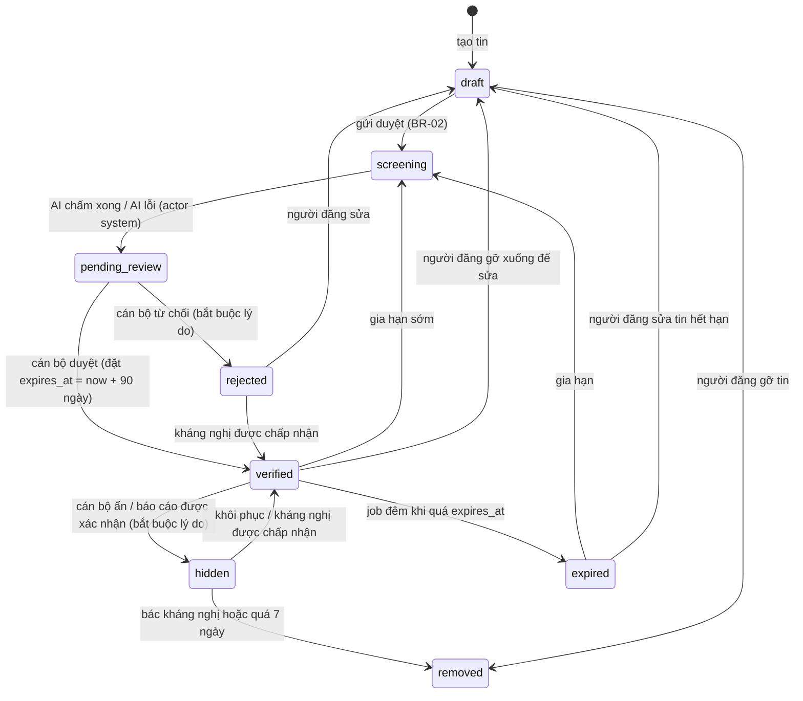

# 01 — Yêu cầu: user story, quy tắc nghiệp vụ, phân quyền

Mỗi user story có mã `US-xxx`, mức ưu tiên và tiêu chí nghiệm thu (AC). Một task trong
[10-implementation-plan.md](10-implementation-plan.md) chỉ xong khi mọi AC của các story nó
phụ trách đều có test tự động hoặc kịch bản kiểm thử tay ghi trong PR.

Mức ưu tiên: **M** = bắt buộc cho MVP; **S** = nên có, làm sau khi M chạy ổn; **C** = có thì tốt.

## Ma trận phân quyền

Quyền được lưu trong bảng `permissions` và gán qua `role_permissions` (seed ở
`db/migrations/0002_seed_reference.sql`). API kiểm tra **quyền**, không kiểm tra tên vai trò.

| Quyền (`permissions.code`) | Khách | student | owner | moderator | admin |
|---|:-:|:-:|:-:|:-:|:-:|
| `scan.create` — Kiểm tra tin | 5 lượt/ngày/IP | ✓ | ✓ | ✓ | ✓ |
| `report.create` — Báo cáo tin / lượt kiểm tra | — | ✓ | — | ✓ | ✓ |
| `listing.create` — Đăng, sửa, gia hạn, gỡ tin của mình | — | ✓ | ✓ | — | — |
| `listing.save` — Lưu tin | — | ✓ | — | — | — |
| `review.create` — Đánh giá | — | ✓ | — | — | — |
| `listing.appeal` — Kháng nghị tin của mình | — | ✓ | ✓ | — | — |
| `listing.moderate` — Duyệt, từ chối, tạm ẩn, khôi phục | — | — | — | ✓ | ✓ |
| `report.resolve` — Xử lý báo cáo | — | — | — | ✓ | ✓ |
| `appeal.resolve` — Xử lý kháng nghị (khác người ra quyết định) | — | — | — | ✓ | ✓ |
| `review.moderate` — Ẩn đánh giá | — | — | — | ✓ | ✓ |
| `owner.verify` — Duyệt giấy tờ, xác minh hồ sơ chủ | — | — | — | ✓ | — |
| `document.view` — Xem giấy tờ qua link 5 phút | — | — | —¹ | ✓ | — |
| `audit.view_own` — Nhật ký thao tác của mình | — | — | — | ✓ | — |
| `audit.view_all` — Toàn bộ nhật ký | — | — | — | — | ✓ |
| `criteria.manage` — Sửa bộ tiêu chí | — | — | — | — | ✓ |
| `model.manage` — Kích hoạt phiên bản mô hình / bộ ngưỡng | — | — | — | — | ✓ |
| `user.manage` — Quản lý tài khoản, vai trò | — | — | — | — | ✓ |
| `stats.view` — Thống kê | — | — | — | — | ✓ |

¹ Chủ hồ sơ xem danh sách giấy tờ của chính mình (tên loại, trạng thái duyệt) qua endpoint `/me`,
không cần quyền `document.view` và không mở lại được tệp. Quản trị viên **không** xem giấy tờ: chỉ
người cần cho công việc mới thấy dữ liệu cá nhân.

Một số endpoint chỉ cần **đăng nhập**, không cần quyền cụ thể (`/me`, `/auth/phone/*`, `/me/scans`):
chúng chỉ đụng tới dữ liệu của chính người gọi. Endpoint trên tin của mình cần `listing.create`
**và** là chủ tin.

Quyền `rental.manage`, `rental.tenant` và vai trò `renter` (người thuê không phải sinh viên) thuộc Giai đoạn 1 sau đồ án:
[12-rental.md](12-rental.md#phân-quyền).

**Tách nhiệm vụ (BR-19):** đăng ký tài khoản luôn gắn vai trò `student` hoặc `owner`, nên một cán bộ
có thể đồng thời là người đăng tin. Người có quyền kiểm duyệt không được duyệt / từ chối / ẩn / khôi
phục tin của chính mình, xác minh hồ sơ chủ của chính mình, hay xử lý báo cáo / kháng nghị về tin của
chính mình → `403 moderation.conflict_of_interest`.

> Khác với bảng phân quyền trong đề cương: sinh viên được đăng tin (theo chỉnh sửa của bạn trong
> đề cương) nên cũng được kháng nghị tin của mình; `listing.save` và `review.create` được thêm để
> phủ tính năng lưu tin và đánh giá đã nêu trong phần Phân tích yêu cầu.

## Quy tắc nghiệp vụ

| Mã | Quy tắc | Nơi bảo đảm |
|---|---|---|
| BR-01 | Tin chỉ hiển thị công khai khi `status = 'verified'` và `expires_at > now()` | Truy vấn công khai + job hết hạn |
| BR-02 | Được gửi tin đi duyệt (và gia hạn) khi: số điện thoại đã xác thực **và** (email thuộc `STUDENT_EMAIL_DOMAINS` đã xác thực **hoặc** có `owner_profiles.verified_until > now()`). Quy tắc dựa trên dữ liệu, không dựa trên tên vai trò | API |
| BR-03 | Tin được duyệt có hạn 90 ngày; gia hạn = sàng lọc lại từ đầu (BR-02 kiểm lại) | API + job đêm |
| BR-04 | Kháng nghị trong 7 ngày kể từ quyết định; người xử lý khác người ra quyết định và khác người đăng tin; tin bị ẩn quá 7 ngày không kháng nghị thì job chuyển sang `removed`. Khi tin có kháng nghị đang mở, mọi chuyển trạng thái khác của tin bị chặn (`409 appeal.pending`) cho tới khi kháng nghị được xử lý | Trigger `check_appeal` + API + job đêm |
| BR-05 | Khách: 5 lượt Kiểm tra tin/ngày/IP. Người dùng đã đăng nhập: 50 lượt/ngày (chống lạm dụng chi phí LLM, cấu hình được). Chỉ tính lượt được tạo (`202`); lượt sàng lọc tin đăng không tính. Lưu ý: cả trường có thể dùng chung một IP công cộng (NAT) nên hạn mức khách hết nhanh — giao diện gợi ý đăng nhập, và `Quota__GuestScansPerDay` chỉnh được | API (Redis) |
| BR-06 | Ảnh: JPEG/PNG/WebP, ≤ 5 MB/ảnh, ≤ 10 ảnh/tin, ≤ 5 ảnh/lượt kiểm tra; kiểm tra magic bytes; mã hóa lại, cạnh dài ≤ 2048 px, xóa EXIF | API |
| BR-07 | Lượt kiểm tra nhanh tự xóa sau 30 ngày; khi có báo cáo trên lượt đó thì giữ 1 năm làm bằng chứng | API + job đêm |
| BR-08 | Mức rủi ro: `score < 40` → Thấp; `40–69` → Cần thận trọng; `≥ 70` → Cao (ngưỡng thuộc phiên bản bộ gộp, admin đổi bằng cách kích hoạt phiên bản khác) | Worker |
| BR-09 | Mọi thay đổi trạng thái tin phải ghi một dòng `listing_transitions` trong cùng transaction, kiểm tra `version` | `ListingTransitionService` + CHECK |
| BR-10 | Mở giấy tờ phải nhập mục đích; link hết hạn sau 5 phút; **mỗi lần cấp link** ghi một dòng `document_access_logs` (link mở lại được trong 5 phút đó, không ghi thêm dòng) | API |
| BR-11 | Hồ sơ chủ xác minh có hiệu lực 12 tháng (`verified_until`); xác minh cần ít nhất một giấy tờ `accepted` | API |
| BR-12 | Một số điện thoại chỉ gắn với một tài khoản. Số chờ xác thực chỉ nằm trong Redis cùng OTP; chỉ ghi `phone_e164` + `phone_verified_at` vào `users` khi xác thực xong (không ai "giữ chỗ" được số của người khác) | UNIQUE `uq_users_phone_e164` + API |
| BR-13 | Sinh viên đăng ký bằng email thuộc danh sách tên miền trường (`STUDENT_EMAIL_DOMAINS`) | API |
| BR-14 | Số điện thoại người đăng chỉ hiển thị cho người đã đăng nhập (giảm cào dữ liệu) | API |
| BR-15 | Mỗi người một báo cáo đang mở cho một đối tượng; mỗi sinh viên một đánh giá cho một tin; không tự đánh giá tin của mình | UNIQUE + trigger `check_review` |
| BR-16 | Tin việc làm bắt buộc có địa điểm làm việc thật (`listings.location` NOT NULL); việc online chỉ dùng được Kiểm tra tin | CSDL |
| BR-17 | Tiền là số nguyên VND; hiển thị dạng `2.500.000 ₫` | API + UI |
| BR-18 | Không tài khoản nào bị xóa cứng; yêu cầu xóa dữ liệu → ẩn danh hóa `users`, gỡ mọi tin, xóa tệp giấy tờ (US-106) | API |
| BR-19 | Tách nhiệm vụ: cán bộ không xử lý tin, hồ sơ, báo cáo, kháng nghị liên quan tới chính mình | API |
| BR-20 | Kết quả AI của lượt sàng lọc tin đăng (`source = listing`) chỉ cán bộ xem; người đăng không xem được điểm và dấu hiệu (tránh dò để lách). Endpoint `/scans*` chỉ phục vụ lượt Kiểm tra tin | API |

BR-21…BR-34 (hợp đồng, hóa đơn, tài khoản nhận tiền) và user story E10–E12 nằm ở [12-rental.md](12-rental.md).

## Vòng đời tin đăng

Ngoài các cạnh trên, người đăng được gỡ tin (`→ removed`, bắt buộc lý do) từ mọi trạng thái trừ
`screening` và `removed`. Danh sách cạnh hợp lệ nằm trong hàm SQL `app.listing_transition_allowed`
(bản 0001, thêm cạnh `expired → draft` ở `0003_review_fixes.sql`) và được CHECK chặn ở CSDL; API phải
kiểm tra trước để trả lỗi rõ ràng (`listing.invalid_transition`). Khi tin có kháng nghị đang mở, API
chặn mọi cạnh khác ngoài cạnh do việc xử lý chính kháng nghị đó (`appeal.pending`, BR-04).

| Từ → Đến | Ai thực hiện | Điều kiện / tác động phụ |
|---|---|---|
| ∅ → draft | Người đăng | Tạo tin + dòng bảng con trong một transaction |
| draft → screening | Người đăng | BR-02; có đúng một dòng bảng con; ≥ 1 ảnh với tin phòng; tạo `scans` (source `listing`, `requester_id` = người đăng) + `outbox_messages` |
| screening → pending_review | system | Khi worker phát sự kiện `scan.completed` (trạng thái `completed` hoặc `failed`) **của lượt sàng lọc mới nhất** của tin; sự kiện của lượt cũ bị giao lại thì bỏ qua |
| pending_review → verified | Cán bộ (không phải người đăng, BR-19) | `expires_at = now() + 90 ngày`; tạo outbox tính embedding |
| pending_review → rejected | Cán bộ (BR-19) | Lý do bắt buộc; gửi email cho người đăng (S) |
| rejected → verified | Người xử lý kháng nghị | Kháng nghị được chấp nhận: `expires_at = now() + 90 ngày` (bắt buộc, CHECK `ck_listings_verified_has_expiry`); tạo outbox tính embedding |
| verified → hidden | Cán bộ (BR-19) | Lý do bắt buộc; thường do xác nhận báo cáo |
| hidden → verified | Cán bộ / người xử lý kháng nghị | Giữ nguyên `expires_at` cũ; nếu đã quá hạn thì tin không hiện công khai (BR-01) và job đêm chuyển sang `expired` |
| hidden → removed | Người xử lý kháng nghị / system | Bác kháng nghị (lý do = ghi chú quyết định), hoặc job đêm khi quá 7 ngày không có kháng nghị đang mở |
| verified → expired | system | Job đêm |
| expired / verified → screening | Người đăng | Gia hạn: BR-02 kiểm lại; tạo lượt sàng lọc mới |
| verified / rejected / expired → draft | Người đăng | Đưa về nháp để sửa; tin rời trang công khai đến khi được duyệt lại |
| mọi trạng thái trừ `screening`, `removed` → removed | Người đăng / người xử lý kháng nghị / system | Lý do bắt buộc (mặc định "Người đăng gỡ") |

## User story

### E1 — Tài khoản và xác thực

**US-101 (M) Sinh viên đăng ký bằng email trường**
- AC1: Email ngoài `STUDENT_EMAIL_DOMAINS` bị từ chối với mã `auth.student_email_domain`.
- AC2: Sau đăng ký, hệ thống gửi mã 6 chữ số (hết hạn 10 phút, tối đa 5 lần nhập sai) và tài khoản
  có vai trò `student` với `email_verified_at` NULL.
- AC3: Nhập đúng mã → `email_verified_at` được đặt; nhập sai quá 5 lần → mã bị hủy, phải xin mã mới.
- AC4: Mật khẩu ≥ 10 ký tự, không nằm trong danh sách mật khẩu phổ biến; lưu Argon2id.

**US-102 (M) Chủ trọ / nhà tuyển dụng đăng ký**
- AC1: Email bất kỳ; tài khoản có vai trò `owner`; phải xác thực email như US-101.
- AC2: Sau đăng ký được dẫn sang tạo hồ sơ chủ (US-501) và xác thực số điện thoại (US-104).

**US-103 (M) Đăng nhập, làm mới phiên, đăng xuất**
- AC1: Đăng nhập trả access token (JWT, 15 phút) trong body và refresh token trong cookie
  `HttpOnly; Secure; SameSite=Strict; Path=/api/v1/auth`.
- AC2: Refresh token xoay vòng mỗi lần dùng; dùng lại token cũ → thu hồi cả họ token, trả `auth.refresh_reused`.
- AC3: Sai mật khẩu 5 lần trong 15 phút → khóa đăng nhập tài khoản đó 15 phút (`auth.locked_temporarily`).
- AC4: Tài khoản `locked` hoặc `anonymized` không đăng nhập được.

**US-104 (M) Xác thực số điện thoại bằng OTP**
- AC1: Chỉ nhận số Việt Nam, chuẩn hóa về E.164 `+84xxxxxxxxx`.
- AC2: OTP 6 số, hết hạn 5 phút, tối đa 3 lần gửi/giờ/số và 5 lần nhập sai.
- AC3: Số đã gắn tài khoản khác → `auth.phone_taken` (BR-12), kiểm cả khi gửi OTP lẫn khi xác thực.
- AC4: Số chờ xác thực lưu trong Redis cùng OTP; nhập đúng mã mới ghi `phone_e164` + `phone_verified_at`.
- AC5: Môi trường dev dùng `ConsoleSmsSender` (in OTP kèm `userId` ra log, không in số điện thoại; API từ
  chối khởi động với `Sms__Provider=console` ở môi trường Production); tài khoản demo đã xác thực sẵn.
- AC6: Khi chưa có nhà cung cấp SMS (mặc định miễn phí, 08-deployment.md), quản trị viên xác thực số thủ
  công sau khi đã gọi điện hoặc gặp trực tiếp chủ số: `POST /admin/users/{id}/phone` (US-801).

**US-105 (S) Quên mật khẩu** — gửi link đặt lại qua email (token một lần, 30 phút); đặt lại xong thu hồi
mọi refresh token và tăng `uver` để access token cũ hết hiệu lực ngay.

**US-106 (M) Yêu cầu xóa dữ liệu**
- AC1: Người dùng xác nhận bằng mật khẩu; trong một transaction hệ thống ẩn danh hóa: `email`,
  `email_verified_at`, `phone_e164`, `phone_verified_at` → NULL (CHECK `ck_users_*_verified_has_*` bắt buộc
  NULL cả cột xác thực), `password_hash` → `'!'` (không đăng nhập được), `full_name` → "Người dùng đã xóa",
  `status` → `anonymized`, `anonymized_at` → now; thu hồi mọi refresh token và tăng `uver`.
- AC2: **Mọi** tin chưa `removed` của người đó chuyển sang `removed` (lý do "Người dùng xóa tài khoản"),
  kể cả tin đang `pending_review`, `hidden`, `draft`. Nếu còn tin đang `screening` (không gỡ được) →
  `409 me.listing_in_screening`, người dùng thử lại sau ít phút.
- AC3: Tệp giấy tờ bị xóa khỏi object storage, dòng `owner_documents` giữ `object_key` NULL + `erased_at`.
- AC4: Lịch sử kiểm duyệt giữ nguyên (khóa ngoại không mồ côi).
- AC5: Bản sao lưu còn dữ liệu cũ tối đa đến hết chu kỳ lưu giữ (07-security.md); trang chính sách riêng tư nêu rõ.

### E2 — Kiểm tra tin

**US-201 (M) Kiểm tra một tin bên ngoài**
- AC1: Nhập văn bản (≤ 10.000 ký tự) và/hoặc tối đa 5 ảnh; phải có ít nhất một trong hai.
- AC2: Tùy chọn nêu giá thuê và phường/xã để bật tín hiệu giá.
- AC3: API trả `202` với `scanId` (UUID) trong ≤ 1 giây tính phía máy chủ (từ lúc nhận xong request);
  không chờ AI.
- AC4: Khách vượt 5 lượt/ngày → `429` mã `scan.quota_exceeded` kèm thời điểm được dùng lại.
- AC5: Mọi lượt kiểm tra nhanh (khách hay đã đăng nhập) có `expires_at = now + 30 ngày` (BR-07).
- AC6: Trang Kiểm tra tin hiện số lượt còn lại trong ngày (`GET /scans/quota`).

**US-202 (M) Xem kết quả theo thời gian thực**
- AC1: Trang kết quả nhận cập nhật qua SignalR; mất kết nối thì poll mỗi 3 giây.
- AC2: Kết quả gồm: điểm 0–100, mức rủi ro bằng chữ + màu, danh sách dấu hiệu (tên tiêu chí, câu
  trích đã che PII, căn cứ pháp lý nếu có), ảnh trùng (số tin khác dùng ảnh này, số tin đã bị gỡ, các
  tin khớp có nằm ở phường/xã khác nhau không), so sánh giá (giá đã dùng để so với trung vị khu vực,
  số mẫu), số báo cáo đã xác nhận trên định danh.
- AC3: Câu chữ trung tính: "Tin này có N dấu hiệu rủi ro". Mức khác Thấp nhưng không có dấu hiệu chữ
  (điểm đến từ ảnh, giá, cộng đồng) có câu tiêu đề riêng (06-frontend.md). Không có chữ "lừa đảo" gắn với tin.
- AC4: Khi AI lỗi: hiện "Chưa phân tích được, vui lòng thử lại" và mã lỗi; không hiện điểm.
- AC5: p95 của `completed_at − created_at` ≤ 10 giây (đo trên môi trường production; số liệu ở
  `reporting.daily_scans.p95_seconds`).

**US-203 (S) Chia sẻ ảnh từ ứng dụng khác vào PWA** — trên Android (trình duyệt nhân Chromium) chọn
"Chia sẻ → Trọ & Việc Sạch" mở trang Kiểm tra tin với ảnh đã gắn sẵn (Web Share Target).

**US-204 (S) Sinh viên xem lịch sử kiểm tra** — danh sách lượt kiểm tra của mình (30 ngày gần nhất), mở lại kết quả.

**US-205 (M) Báo cáo một lượt kiểm tra** — người dùng có `report.create` báo cáo lượt Kiểm tra tin
(ví dụ đã bị lừa thật); lượt đó được giữ 1 năm (BR-07); mỗi người một báo cáo đang mở cho một lượt.
Lượt sàng lọc tin đăng không báo cáo được (báo cáo tin theo US-406).

### E3 — Tin đăng (người đăng)

**US-301 (M) Tạo tin phòng (nháp)** — tiêu đề ≤ 150, mô tả 30–5.000 ký tự, phường/xã, địa chỉ,
ghim vị trí trên bản đồ, giá thuê, tiền cọc (để trống = chưa nêu, 0 = không cọc), diện tích, khép
kín, tiện nghi. Lưu ở trạng thái `draft`.

**US-302 (M) Tạo tin việc (nháp)** — phần chung như US-301 (tiêu đề, mô tả, phường/xã, địa chỉ), tên
nơi làm việc, mức lương + đơn vị (giờ/buổi/ngày/tháng), số giờ/tuần (1–48), địa điểm thật trên bản đồ.

**US-303 (M) Tải ảnh tin** — tối đa 10 ảnh, kéo thả sắp thứ tự; thêm, xóa, sắp ảnh chỉ khi tin ở `draft`;
ảnh trùng hệt (cùng SHA-256) trong cùng tin bị từ chối `image.duplicate`.

**US-304 (M) Gửi duyệt**
- AC1: Không đạt BR-02 → `listing.poster_not_verified` kèm danh sách việc còn thiếu.
- AC2: Thành công: tin sang `screening`, có lượt sàng lọc mới; người đăng thấy "Đang sàng lọc".
- AC3: Sau khi AI xong (hoặc lỗi), tin sang `pending_review` và vào hàng đợi.

**US-305 (M) Gia hạn tin** — được gia hạn khi tin `expired` hoặc còn ≤ 7 ngày và vẫn đạt BR-02; tin
quay lại `screening` (rời trang công khai tới khi được duyệt lại).

**US-306 (M) Gỡ tin** — người đăng gỡ bất kỳ lúc nào trừ khi đang `screening` hoặc có kháng nghị đang mở;
lý do mặc định "Người đăng gỡ".

**US-307 (M) Sửa tin** — chỉ sửa được ở `draft`; tin `rejected`, `verified` hoặc `expired` phải chuyển về
`draft` trước (tin `verified` bị gỡ khỏi trang công khai cho đến khi duyệt lại). Mọi lần sửa gửi kèm
`version`; lệch → `409 listing.version_conflict`.

**US-308 (M) Xem trạng thái và lịch sử** — người đăng thấy dòng thời gian các lần chuyển trạng thái
kèm lý do; không thấy tên cán bộ (chỉ thấy "Cán bộ xác minh") và không thấy điểm AI của tin (BR-20).

### E4 — Tìm và xem tin

**US-401 (M) Tìm tin có bộ lọc và bản đồ** — lọc loại tin, khoảng giá, bán kính quanh một điểm
(mặc định quanh cơ sở đào tạo đã chọn; không gửi tọa độ thì dùng cơ sở đầu tiên trong `Campuses__Json`),
tiện nghi, khép kín; xem dạng danh sách và bản đồ; API p95 ≤ 500 ms.

**US-402 (M) Tìm bằng câu tự nhiên** — ví dụ "phòng khép kín gần trường dưới 2,5 triệu có chỗ để xe":
điều kiện cứng (giá, bán kính, tiện nghi nhận ra được, "khép kín" → `selfContained`) thành bộ lọc SQL;
phần còn lại xếp hạng bằng hybrid search (full-text + vector, gộp bằng Reciprocal Rank Fusion). Dịch vụ
embedding lỗi → tự rơi về full-text, không báo lỗi cho người dùng. Phần câu còn lại rỗng (mọi từ đã thành
bộ lọc) → trả kết quả như tìm có bộ lọc, sắp theo khoảng cách.

**US-403 (M) Xem chi tiết tin** — ảnh, thông tin, bản đồ, nhãn "Đã xác minh" kèm ngày hết hạn,
số điện thoại người đăng (chỉ khi đăng nhập, BR-14), đánh giá đã công khai.

**US-404 (S) Lưu tin** — lưu / bỏ lưu; danh sách tin đã lưu hiển thị cả tin đã hết hạn kèm nhãn; tin
nay không còn công khai vì lý do khác (ẩn, gỡ, về nháp) chỉ hiện "Tin không còn hiển thị", không lộ nội dung.

**US-405 (S) Đánh giá** — sinh viên chấm 1–5 sao, nhận xét tùy chọn ≤ 1.000 ký tự; mỗi người một
đánh giá cho một tin; không tự đánh giá tin mình đăng; chỉ đánh giá tin đang công khai hoặc đã hết hạn.

**US-406 (M) Báo cáo tin** — chọn loại (`scam`, `misleading`, `inappropriate`, `other`) và ghi chú tùy chọn.

### E5 — Xác minh chủ trọ / nhà tuyển dụng

**US-501 (M) Tạo hồ sơ chủ** — cá nhân hoặc doanh nghiệp; doanh nghiệp bắt buộc tên và mã số thuế
(10 số hoặc 10-3 số).

**US-502 (M) Tải giấy tờ**
- AC1: Phải tích ô đồng ý xử lý dữ liệu cá nhân trước khi tải (`consent_at`).
- AC2: JPEG/PNG/WebP/PDF ≤ 10 MB (tính trên bản rõ); mã hóa AES-256-GCM trước khi lưu; cùng một tệp
  (SHA-256) đã có → từ chối `document.duplicate`. Nếu tệp trùng thuộc **tài khoản khác**, API ghi log cảnh
  báo kèm `userId` của hai tài khoản để người vận hành rà soát (MVP không có hàng đợi cờ riêng).

**US-503 (M) Cán bộ duyệt giấy tờ và xác minh hồ sơ** — duyệt từng giấy tờ (chấp nhận/từ chối);
xác minh hồ sơ đặt `verified_until = now + 12 tháng`, cần ít nhất một giấy tờ `accepted`
(`owner.no_accepted_document`); không xác minh hồ sơ của chính mình (BR-19).

**US-504 (S) Xóa giấy tờ** — chủ hồ sơ xóa giấy tờ của mình; tệp bị xóa, dòng giữ `erased_at`.

### E6 — Kiểm duyệt (cán bộ xác minh)

**US-601 (M) Hàng đợi duyệt** — tin `pending_review` sắp theo điểm rủi ro giảm dần rồi thời gian
chờ; tin AI lỗi (không có điểm) lên đầu để xem tay; hiển thị mức rủi ro, số dấu hiệu, thời gian chờ;
cập nhật khi có tin mới.

**US-602 (M) Xem chi tiết để duyệt** — nội dung tin, kết quả AI kèm bằng chứng, ảnh trùng (mở được
tin khớp), tín hiệu giá, lịch sử tin, hồ sơ chủ và danh sách giấy tờ (mở giấy tờ theo US-605).

**US-603 (M) Duyệt / từ chối** — gửi kèm `version`; hai cán bộ thao tác cùng lúc thì người sau nhận
`409 listing.version_conflict`; từ chối bắt buộc lý do; không duyệt tin của chính mình (BR-19).

**US-604 (M) Tạm ẩn / khôi phục tin đang công khai** — bắt buộc lý do khi ẩn; tin đang có kháng nghị mở
thì không khôi phục trực tiếp mà xử lý qua kháng nghị (`appeal.pending`).

**US-605 (M) Mở giấy tờ** — nhập mục đích → nhận link hết hạn 5 phút → mỗi lần cấp link ghi nhật ký (BR-10).

**US-606 (M) Xử lý báo cáo** — cán bộ xem được nội dung và ảnh của lượt kiểm tra bị báo cáo
(`GET /moderation/reports/{id}`); xác nhận (bắt buộc ghi chú) → cộng bộ đếm cho các định danh liên quan
(trigger) và gợi ý ẩn tin; bác bỏ (bắt buộc ghi chú).

**US-607 (M) Xử lý kháng nghị** — chấp nhận → tin về `verified` (từ `rejected` thì đặt `expires_at` mới);
bác → tin `removed` (nếu đang `hidden`) hoặc giữ `rejected`. Người đã ra quyết định không xử lý được
(`appeal.decider_conflict`); người đăng tin cũng không (BR-19).

**US-608 (S) Ẩn đánh giá vi phạm** — bắt buộc lý do.

**US-609 (S) Nhật ký thao tác của tôi** — danh sách quyết định và lần mở giấy tờ của chính cán bộ.

### E7 — Kháng nghị (người đăng)

**US-701 (M) Gửi kháng nghị** — trong 7 ngày kể từ quyết định từ chối/ẩn đang có hiệu lực; mỗi tin
một kháng nghị đang mở; lý do ≤ 1.000 ký tự. Quá hạn → `appeal.window_closed`.

**US-702 (M) Theo dõi kháng nghị** — trạng thái và ghi chú quyết định.

### E8 — Quản trị

**US-801 (M) Quản lý người dùng** — tìm theo email, khóa/mở khóa, gán/thu hồi vai trò (không tự thu
hồi `admin` và không tự khóa chính mình); xác thực số điện thoại thủ công khi chưa có nhà cung cấp SMS
(US-104 AC6). Tài khoản `system` không hiện trong danh sách và không thao tác được.

**US-802 (M) Bộ tiêu chí** — thêm, sửa câu chữ hướng dẫn, ngừng dùng (`is_active = false`); không xóa.

**US-803 (M) Phiên bản mô hình** — xem các phiên bản theo thành phần; kích hoạt một phiên bản bộ gộp
khác (đổi bộ ngưỡng) trong một transaction.

**US-804 (S) Thống kê** — lượt kiểm tra theo ngày và mức rủi ro, p95 thời gian xử lý, thời gian duyệt
trung vị, phân bố điểm (từ materialized view). View chỉ phản ánh dữ liệu còn lưu: lượt kiểm tra nhanh
quá 30 ngày đã bị xóa nên số của những ngày đó giảm dần (T5.2 xuất số liệu hằng tuần).

**US-805 (M) Nhật ký** — toàn bộ chuyển trạng thái tin và lần mở giấy tờ, lọc theo người và thời gian.

### E9 — Tác vụ hệ thống

**US-901 (M) Job hằng đêm (02:00 giờ Việt Nam)** — chuyển tin quá hạn sang `expired`; chuyển tin bị
ẩn quá 7 ngày không có kháng nghị đang mở sang `removed`; xóa lượt kiểm tra hết hạn (kèm tệp ảnh) trừ
lượt có báo cáo đang mở; dọn `outbox_messages` đã gửi quá 7 ngày; làm mới materialized view.

**US-902 (S) Email thông báo** — người đăng nhận email khi tin được duyệt, bị từ chối, bị ẩn, kháng
nghị có kết quả.

## Yêu cầu phi chức năng

| Nhóm | Yêu cầu | Cách kiểm chứng |
|---|---|---|
| Hiệu năng | Kiểm tra tin p95 ≤ 10 s; API danh sách p95 ≤ 500 ms với 50 người dùng đồng thời | k6 (09-testing.md) |
| Bảo mật | HTTPS; JWT 15 phút + refresh token xoay vòng; Argon2id; giới hạn tần suất theo IP và tài khoản | OWASP ZAP baseline, test phân quyền tự động |
| Tệp tải lên | BR-06; giấy tờ mã hóa ở tầng ứng dụng | Test với tệp giả đuôi, tệp quá cỡ |
| Riêng tư | Che PII trước khi gửi LLM; định danh lưu HMAC; xóa lượt kiểm tra sau 30 ngày | Test đơn vị lớp che PII; rà log gọi LLM |
| Truy vết | Mọi quyết định duyệt, ẩn, gỡ và mọi lần mở giấy tờ ghi vào bảng chỉ-thêm | Test: UPDATE/DELETE trên bảng log bị từ chối |
| Độ sẵn sàng | Uptime ≥ 99% trong thử nghiệm; sao lưu PITR, RPO ≤ 5 phút, RTO ≤ 1 giờ | Uptime monitor; biên bản diễn tập khôi phục |
| Di động | Mobile-first; PWA cài được; Lighthouse ≥ 90 cho Performance và Accessibility | Lighthouse (mobile) chạy ở T3.8 và trước buổi bảo vệ, ghi kết quả vào báo cáo |
| Ngôn ngữ | Toàn bộ giao diện tiếng Việt; giờ hiển thị theo `Asia/Ho_Chi_Minh` | Review |
