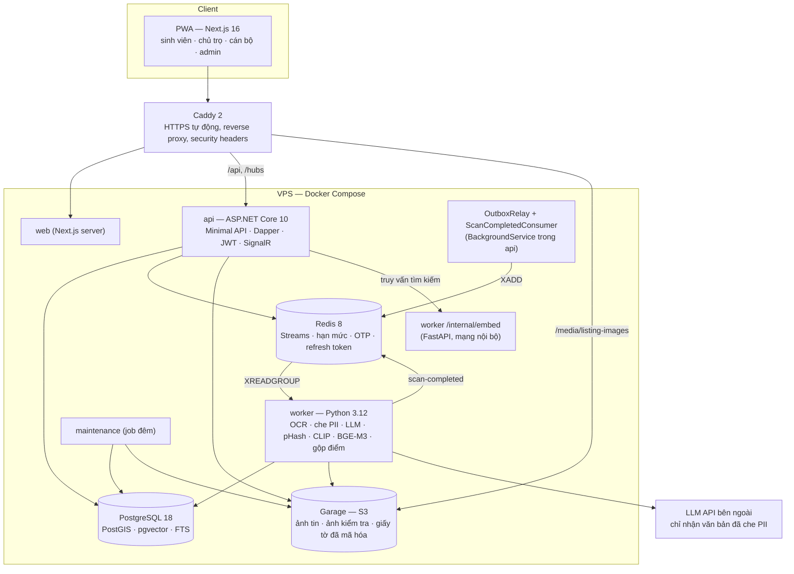
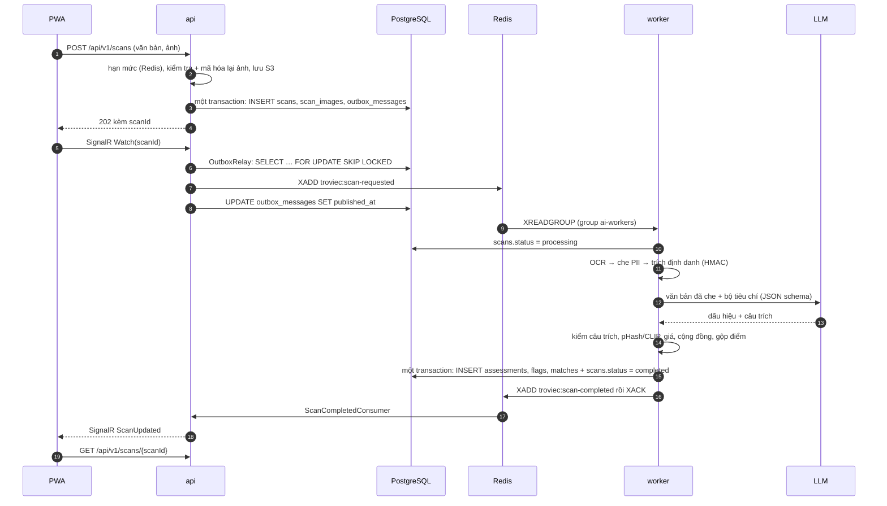

# 02 — Kiến trúc hệ thống

API chỉ ghi yêu cầu, đẩy việc vào hàng đợi rồi trả lời ngay; AI worker xử lý xong thì báo lại để
API đẩy kết quả về trình duyệt qua SignalR. Nhờ vậy LLM chậm hay lỗi cũng không làm treo giao diện.

## Sơ đồ thành phần



| Thành phần | Trách nhiệm | Không được làm |
|---|---|---|
| `web` | Giao diện PWA, SSR trang công khai (chi tiết tin cho SEO), gọi API bằng client sinh từ OpenAPI | Gọi thẳng CSDL, Redis, S3; giữ access token ngoài bộ nhớ |
| `api` | Xác thực, phân quyền, nghiệp vụ, ghi CSDL, nhận tệp tải lên, outbox, SignalR | Gọi LLM; xử lý ảnh nặng (chỉ kiểm tra + mã hóa lại) |
| `worker` | Pipeline AI cho mỗi lượt sàng lọc; tính embedding tin; dịch vụ embedding nội bộ | Đọc `users`, hồ sơ chủ, giấy tờ, báo cáo; đổi trạng thái tin |
| `maintenance` | Job đêm (US-901) với role `app_maintenance` | Mọi thao tác khác |
| PostgreSQL | Nguồn dữ liệu duy nhất (quan hệ + vector + không gian + full-text) | — |
| Redis | Hàng đợi (Streams), bộ đếm hạn mức, OTP, refresh token | Lưu dữ liệu nghiệp vụ bền vững |
| Garage | Lưu tệp qua S3 API: 3 bucket (`listing-images` công khai qua website mode, `scan-images` và `owner-documents` riêng tư) | — |

## Luồng chính

### Kiểm tra tin



### Gửi tin đi duyệt

1. `POST /api/v1/listings/{id}/submit` kèm `version`.
2. API kiểm BR-02, rồi trong **một transaction**: cập nhật `listings` (status `screening`,
   `version + 1`, điều kiện `version = @version`), ghi `listing_transitions`, tạo `scans`
   (source `listing`, `input_text` = tiêu đề + mô tả lúc gửi), ghi định danh số điện thoại người
   đăng vào `identifiers` + `scan_identifiers`, ghi `outbox_messages`.
3. Worker chấm như luồng trên (đọc ảnh từ `listing_images`, tính `phash`/`clip_embedding` còn thiếu).
4. `ScanCompletedConsumer` nhận sự kiện có `listingId` → chuyển `screening → pending_review`
   (actor system) → đẩy `QueueChanged` qua hub kiểm duyệt.

### Tìm bằng câu tự nhiên

1. API tách điều kiện cứng từ câu bằng bộ phân tích luật (giá: "dưới 2,5 triệu", "2tr5"; tiện nghi
   theo từ khóa trong bảng `amenities`; "gần trường" → bán kính mặc định quanh cơ sở đã chọn).
2. API gọi `POST http://worker:8001/internal/embed` (timeout 800 ms) lấy vector câu hỏi.
3. Một câu SQL: full-text (`search_tsv`) và vector (`listing_embeddings`, HNSW) đều áp bộ lọc cứng,
   lấy top 100 mỗi bên, gộp bằng Reciprocal Rank Fusion (`k = 60`). Truy vấn mẫu: [03-database.md](03-database.md#tìm-kiếm-hybrid-rrf).
4. Lỗi hoặc quá thời gian ở bước 2 → chỉ chạy nhánh full-text.

### Mở giấy tờ xác minh

1. Cán bộ nhập mục đích → `POST /api/v1/moderation/owner-documents/{id}/access`.
2. API kiểm `document.view`, ghi `document_access_logs`, trả URL `/api/v1/files/documents/{token}`
   với token HMAC hết hạn sau 5 phút.
3. `GET` URL đó: API kiểm token, đọc bản mã từ S3, giải mã AES-256-GCM, trả về với
   `Cache-Control: no-store` và `Content-Disposition: inline`.

## Hợp đồng giữa các thành phần

| Kênh | Tên | Nội dung (chi tiết ở 05-ai-worker.md) | Bên ghi → bên đọc |
|---|---|---|---|
| Redis Stream | `troviec:scan-requested` | `{"scanId": 123}` | api (OutboxRelay) → worker, group `ai-workers` |
| Redis Stream | `troviec:listing-embed` | `{"listingId": 45}` | api (OutboxRelay) → worker, group `ai-workers` |
| Redis Stream | `troviec:scan-completed` | `{"scanId", "publicId", "status", "source", "listingId"}` | worker → api, group `api` |
| Redis Stream | `troviec:dead-letter` | việc lỗi quá 3 lần | worker → người vận hành |
| HTTP nội bộ | `POST worker:8001/internal/embed` | `{"texts": [...]}` → vector 1024 chiều | api → worker, header `X-Internal-Token` |
| SignalR | `/hubs/scans`, `/hubs/moderation` | xem [04-api.md](04-api.md#signalr) | api → web |
| CSDL | Bảng `app.*` | quyền theo role, xem migration | mọi thành phần |

Đảm bảo giao việc: **at-least-once**. Mọi bên nhận phải idempotent:
worker ghi điểm bằng `INSERT … ON CONFLICT (scan_id, aggregator_model_id) DO NOTHING`;
`ScanCompletedConsumer` chỉ chuyển trạng thái khi tin còn ở `screening`.

## Cấu trúc repo

```text
troviec/
├── AGENTS.md · CLAUDE.md · README.md · .env.example · Makefile
├── docs/                         # bộ tài liệu này
├── db/
│   ├── init/00_init.sh           # superuser: extension, role, schema (chạy 1 lần)
│   ├── migrations/               # 0001_init.sql, 0002_seed_reference.sql, ...
│   └── seed/                     # đơn vị hành chính, dữ liệu demo
├── apps/
│   ├── api/                      # .NET 10
│   │   ├── TroViec.slnx
│   │   ├── src/TroViec.Api/
│   │   ├── src/TroViec.Migrator/     # DbUp + lệnh bootstrap-admin
│   │   ├── src/TroViec.Maintenance/  # job đêm
│   │   └── tests/TroViec.Api.Tests/
│   ├── worker/                   # Python 3.12 + uv
│   │   ├── pyproject.toml
│   │   ├── src/troviec_worker/
│   │   ├── models/aggregator/    # agg-v0.json, agg-v1.json (trọng số + ngưỡng)
│   │   └── tests/
│   └── web/                      # Next.js 16
├── research/                     # hướng dẫn gán nhãn, notebook, script E1–E7
├── infra/
│   ├── docker-compose.yml        # dev
│   ├── docker-compose.prod.yml
│   ├── postgres/Dockerfile
│   ├── caddy/Caddyfile
│   └── garage/garage.toml
└── .github/workflows/            # ci.yml, deploy.yml
```

### Backend: Minimal API + vertical slice

Mỗi tính năng là một thư mục trong `Features/`, chứa endpoint, request/response, validator và SQL
của chính nó. Không có tầng repository chung; dùng chung chỉ ở `Infrastructure/`.

```text
src/TroViec.Api/
├── Program.cs                   # đăng ký service, middleware, MapGroup theo feature
├── Infrastructure/
│   ├── Db/                      # NpgsqlDataSource, DbEnum, Dapper type handler, PgErrorMapper
│   ├── Auth/                    # JWT, refresh token (Redis), PasswordHasher (Argon2id), Permissions
│   ├── Storage/                 # IObjectStorage (S3), ImagePipeline (kiểm tra + mã hóa lại), DocumentCipher (AES-GCM)
│   ├── Messaging/               # OutboxRelay, ScanCompletedConsumer, RedisStreams
│   ├── Notifications/           # IEmailSender (MailKit), ISmsSender (Console / nhà cung cấp)
│   ├── RateLimiting/            # QuotaService (Redis), policy theo IP
│   ├── Problems/                # ProblemDetails + mã lỗi (04-api.md)
│   └── Crypto/                  # IdentifierHasher (HMAC-SHA256), SignedUrlService
├── Domain/                      # enum + value object: ListingStatus, RiskLevel, PhoneNumber, Vnd
├── Realtime/                    # ScanHub, ModerationHub
└── Features/
    ├── Auth/  Me/  Scans/  Listings/  Search/  OwnerProfiles/
    ├── Moderation/  Reports/  Appeals/  Reviews/  Admin/  Meta/
    └── Listings/
        ├── ListingEndpoints.cs          # MapGroup("/api/v1/listings")
        ├── CreateListing.cs             # record Request/Response + Validator + Handler
        ├── SubmitListing.cs
        ├── ListingTransitionService.cs  # nơi DUY NHẤT đổi listings.status
        └── ListingQueries.cs            # SQL đọc dùng chung trong feature
```

### Worker và web

Cấu trúc chi tiết: [05-ai-worker.md](05-ai-worker.md#cấu-trúc-mã) và [06-frontend.md](06-frontend.md#cấu-trúc-mã).

## Quyết định kiến trúc

| # | Quyết định | Lý do | Phương án đã loại |
|---|---|---|---|
| ADR-01 | **.NET 10 LTS** thay cho .NET 8 trong đề cương | .NET 8 và 9 hết hỗ trợ ngày 10/11/2026; .NET 10 là LTS, hỗ trợ đến 11/2028 | Ở lại .NET 8: không còn bản vá bảo mật |
| ADR-02 | Minimal API + vertical slice + Dapper | SQL tường minh, dễ tối ưu từng truy vấn, ít lớp trừu tượng cho AI agent viết sai | EF Core: khó kiểm soát SQL cho truy vấn vector/không gian |
| ADR-03 | Một PostgreSQL cho quan hệ, vector, không gian, full-text | Ít thành phần phải vận hành; ràng buộc toàn vẹn xuyên suốt | Elasticsearch/Qdrant riêng: thêm hạ tầng, dữ liệu lệch nhau |
| ADR-04 | Redis Streams + transactional outbox | Không mất việc khi Redis lỗi đúng lúc CSDL đã ghi; consumer group cho nhiều worker | Gọi worker qua HTTP đồng bộ: treo request khi LLM chậm |
| ADR-05 | **Garage** (S3-compatible) thay cho MinIO | MinIO Community ngừng phát hành bản build từ 10/2025 và repo bị lưu trữ năm 2026; Garage nhẹ, chạy một node | Giữ MinIO: không còn bản vá; code dùng S3 API nên đổi nhà cung cấp chỉ là đổi cấu hình |
| ADR-06 | Giấy tờ mã hóa AES-256-GCM ở tầng ứng dụng, xem qua API bằng token 5 phút | Không phụ thuộc tính năng mã hóa của storage; khóa không nằm cùng chỗ với dữ liệu | Presigned URL trên bucket SSE: phụ thuộc nhà cung cấp |
| ADR-07 | Worker Python tách riêng, giao tiếp qua CSDL + Redis | Hệ sinh thái AI đầy đủ; scale và giới hạn quyền riêng | Gọi model từ .NET (ONNX): ít thư viện cho OCR/NLP tiếng Việt |
| ADR-08 | LLM qua adapter trung lập nhà cung cấp (giao thức OpenAI-compatible, JSON schema) | Đổi nhà cung cấp không ảnh hưởng phần còn lại; có phương án tự host | Gắn chặt SDK một nhà cung cấp |
| ADR-09 | PWA thay vì app native | Một mã nguồn, cài được, Web Share Target trên Android | React Native: gấp đôi khối lượng |
| ADR-10 | JWT tự phát hành + refresh token xoay vòng lưu Redis | Không cần UI của ASP.NET Identity; phát hiện dùng lại token | Cookie session thuần: khó dùng cho SignalR + PWA |
| ADR-11 | Một VPS + Docker Compose + Caddy | Đủ cho quy mô thử nghiệm; dựng lại bằng một lệnh; HTTPS tự động | Kubernetes: quá nặng cho đồ án |

## Phiên bản công nghệ

Ghi phiên bản patch cụ thể vào lockfile (`packages.lock.json`, `uv.lock`, `pnpm-lock.yaml`) khi tạo
project; cập nhật bản vá bảo mật hằng tháng (Dependabot).

| Lớp | Công nghệ |
|---|---|
| Backend | .NET 10 (LTS), ASP.NET Core Minimal API, Npgsql, Dapper, Pgvector (.NET, có handler cho Dapper), FluentValidation, StackExchange.Redis, AWSSDK.S3, MailKit, Konscious.Security.Cryptography.Argon2, SixLabors.ImageSharp¹, DbUp (dbup-postgresql), Microsoft.AspNetCore.OpenApi + Scalar.AspNetCore |
| Kiểm thử .NET | xUnit v3, Testcontainers (PostgreSQL, Redis), Shouldly² |
| CSDL | PostgreSQL 18, PostGIS 3.6, pgvector 0.8.x — image tự build từ `postgis/postgis:18-3.6` |
| Hàng đợi / cache | Redis 8 (hoặc Valkey 8) |
| Lưu trữ tệp | Garage v2.x (S3 API) |
| AI worker | Python 3.12, uv, FastAPI, psycopg 3, redis-py, pydantic 2, httpx, boto3, Pillow, imagehash, pytesseract + `tesseract-ocr-vie`, open_clip_torch, sentence-transformers (BGE-M3), transformers (PhoBERT), torch bản CPU, underthesea, regex, numpy, scikit-learn (chỉ cho nghiên cứu) |
| Frontend | Node.js 24 LTS, pnpm, Next.js 16 (App Router), React 19, TypeScript, Tailwind CSS 4, shadcn/ui, TanStack Query, react-hook-form + zod, openapi-typescript + openapi-fetch, @microsoft/signalr, maplibre-gl + react-map-gl, sonner, date-fns |
| Kiểm thử web | Vitest + Testing Library, Playwright |
| Hạ tầng | Docker Compose, Caddy 2, GitHub Actions, GHCR, WAL-G |

¹ ImageSharp dùng Six Labors Split License: miễn phí cho dự án mã nguồn mở và phi thương mại như đồ án;
nếu thương mại hóa phải xem lại giấy phép hoặc chuyển sang SkiaSharp.
² Không dùng FluentAssertions bản 8 trở lên vì đã chuyển sang giấy phép thương mại.
