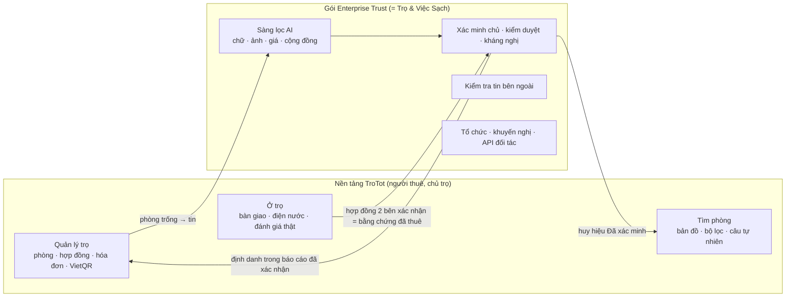
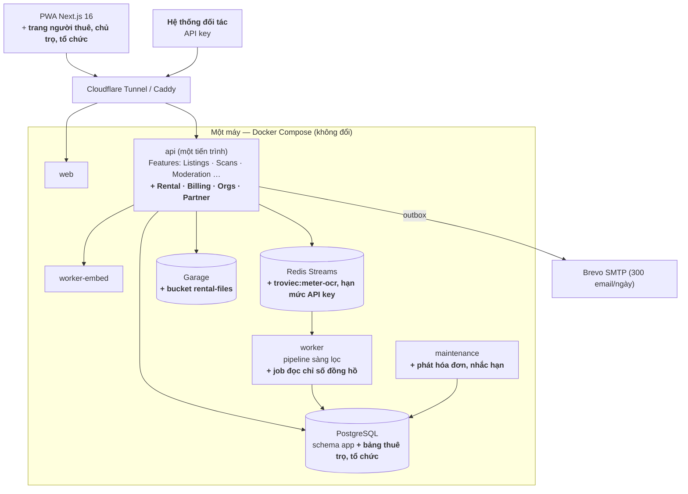

# 11 — Tầm nhìn sản phẩm: nền tảng thuê trọ và gói Enterprise

> Tài liệu định hướng **sau đồ án**. Không có task nào trong [10-implementation-plan.md](10-implementation-plan.md)
> phụ thuộc vào file này, và nó không thay đổi phạm vi chấm điểm. Khi bắt đầu một giai đoạn ở đây, phải cập nhật
> các tài liệu nguồn sự thật (mục [Tài liệu phải sửa khi bắt đầu](#tài-liệu-phải-sửa-khi-bắt-đầu)) trước khi code.

## Tóm tắt

**TroTot** (tên tạm, theo tên repo) là nền tảng tìm phòng, thuê phòng và quản lý phòng trọ. Đối tượng là sinh viên,
công nhân, người đi làm và chủ trọ nhỏ.

**Trọ & Việc Sạch** — dự án đang làm — trở thành **gói Enterprise "Trust"** của nền tảng. Gói này bán cho tổ chức
cần bảo vệ người của mình: trường đại học, doanh nghiệp, khu công nghiệp, sàn rao vặt. Nội dung gói gồm:

- xác minh chủ trọ và nhà tuyển dụng;
- chấm điểm rủi ro tin bằng AI;
- kiểm duyệt bởi con người, có kháng nghị;
- Kiểm tra tin cho tin bên ngoài;
- báo cáo và nhật ký.

Ba quyết định định hình toàn bộ thiết kế:

1. **Không viết lại, mà mở rộng.** Nền tảng dùng chung mã nguồn và chung một tiến trình `api` với dự án hiện tại.
   Nó chỉ thêm các vertical slice mới trong `Features/*` và các bảng mới trong schema `app`. Đây là một modular
   monolith, không tách microservice.
2. **Giữ nguyên hạ tầng 0 đồng đang chạy** ([08-deployment.md](08-deployment.md#chi-phí-và-dịch-vụ-miễn-phí)).
   - Hạ tầng tự host: một máy chạy Docker Compose; PostgreSQL 18 + PostGIS + pgvector; Redis Streams; Garage; Caddy.
   - Đưa ra Internet: Cloudflare Tunnel hoặc Oracle Always Free.
   - Dịch vụ ngoài, đều dùng gói miễn phí: Brevo cho email, GHCR + GitHub Actions cho CI/CD, OpenFreeMap cho bản đồ,
     Backblaze B2 cho sao lưu, UptimeRobot cho giám sát.
   - Mọi tính năng mới phải chạy được trên đúng bộ này. Tính năng nào chỉ làm được bằng dịch vụ trả phí thì hoãn.
3. **An toàn không bán được bằng tiền.** Gói trả phí, tin nổi bật hay xác nhận của tổ chức không bao giờ làm thay đổi
   điểm rủi ro, thứ tự hàng đợi kiểm duyệt hay quyết định của cán bộ.

## Hai lớp sản phẩm



Hai mũi tên đối nhau giữa hai lớp tạo nên **vòng dữ liệu**. Không trang rao vặt hay app quản lý trọ nào có vòng này:

- **Từ nền tảng sang Trust:** hợp đồng mà cả hai bên đã xác nhận là bằng chứng "người này đã thuê thật". Bằng chứng
  đó làm đánh giá và xác minh chủ trọ đáng tin hơn.
- **Từ Trust sang nền tảng:** trước khi hiện mã VietQR, hệ thống so HMAC số tài khoản của chủ trọ với
  `app.identifier_stats`. Nếu số này nằm trong báo cáo đã xác nhận, người thuê được cảnh báo.

### Module hiện có thuộc lớp nào

| Module trong `apps/api/src/TroViec.Api/Features` | Lớp | Ghi chú |
|---|---|---|
| `Auth`, `Me`, `Meta`, `Admin` | Dùng chung | Không đổi |
| `Listings`, `Search`, `Reviews` | Nền tảng | `Reviews` được nâng cấp (đánh giá gắn hợp đồng) |
| `Scans`, `Moderation`, `OwnerProfiles`, `Reports`, `Appeals` | Trust | Giữ nguyên hành vi; thêm phạm vi tổ chức ở giai đoạn 3 |
| Worker: OCR, che PII, tín hiệu chữ/ảnh/giá/cộng đồng, embedding | Trust (embedding dùng chung cho tìm kiếm) | Thêm job đọc chỉ số đồng hồ ở giai đoạn 2 |

## Tính năng theo nhóm người dùng

Cột **GĐ** là giai đoạn (xem [Lộ trình](#lộ-trình)). "Không" nghĩa là đã cân nhắc và loại, kèm lý do.

### Người thuê

| Tính năng | GĐ | Cách làm trên hạ tầng hiện tại |
|---|---|---|
| Tìm trên bản đồ, bộ lọc, câu tự nhiên | Đã có | `Search` hybrid (FTS + BGE-M3 + RRF), MapLibre + OpenFreeMap |
| Tìm theo thời gian đi lại tới trường / KCN | 3 | Tính sẵn isochrone cho vài điểm cố định bằng công cụ định tuyến mã nguồn mở chạy **một lần trên máy cá nhân**, nạp vào PostGIS. Không cần dịch vụ chạy thường trực. Hiển thị là "ước tính" |
| Đặt lịch xem phòng | 2 | Chủ trọ mở khung giờ, người thuê đặt, nhắc qua email. Kèm lời khuyên "không chuyển cọc trước khi xem phòng" |
| Hợp đồng điện tử | 1 | Mẫu hợp đồng có cấu trúc; hai bên xác nhận bằng OTP email (đã có hạ tầng OTP trong Redis); lưu SHA-256 của nội dung chuẩn hóa. **Không phải chữ ký số**, ghi rõ trên hợp đồng |
| Biên bản bàn giao có ảnh | 2 | Ảnh vào bucket riêng tư mới `rental-files`; giờ chụp lấy giờ máy chủ, không lấy EXIF; người thuê bấm xác nhận |
| Trả tiền thuê qua VietQR | 1 | API sinh chuỗi VietQR (chuẩn EMVCo, CRC16, ~50 dòng C#, không thư viện). Tiền đi **thẳng** vào tài khoản chủ trọ; mỗi hóa đơn có mã nội dung chuyển khoản riêng |
| Xem hóa đơn, lịch sử thanh toán, nhắc gia hạn | 1 | Job đêm hiện có (`TroViec.Maintenance`) gửi email 30 ngày trước ngày hết hạn |
| Đánh giá chỉ từ người thuê thật | 2 | Đánh giá tin phòng phải gắn hợp đồng hai bên đã xác nhận và đã ở ≥ 30 ngày (xem [Mô hình dữ liệu](#mô-hình-dữ-liệu-bổ-sung)) |
| Ghép bạn ở cùng | Không | Rủi ro quấy rối và lộ thông tin cá nhân; cần nhiều người dùng mới có ích; không tạo tín hiệu tin cậy |
| Báo hỏng hóc | 3 | CRUD đơn giản, không gấp |

### Chủ trọ nhỏ

| Tính năng | GĐ | Cách làm |
|---|---|---|
| Quản lý tòa, phòng, trạng thái phòng | 1 | Bảng `properties`, `rooms` |
| Sinh tin đăng từ phòng trống | 1 | Tạo bản nháp `app.listings` từ dữ liệu phòng. Tin **vẫn qua sàng lọc AI và kiểm duyệt** như mọi tin khác (`ListingTransitionService`) |
| Hóa đơn tháng: tiền phòng, điện, nước, dịch vụ | 1 | Chỉ số nhập tay; chủ trọ duyệt trước khi phát hành |
| Đọc chỉ số đồng hồ từ ảnh | 2 | Tái dùng Tesseract của worker qua stream mới. OCR **chỉ gợi ý** con số, chủ trọ xác nhận |
| Ghi nhận đã thu tiền | 1 | Chủ trọ bấm "đã nhận". Không coi ảnh chụp màn hình chuyển khoản là bằng chứng |
| Đối soát ngân hàng tự động | Hoãn | Cần dịch vụ bên thứ ba; khi làm, viết thành adapter để đổi được nhà cung cấp |
| Nhắc nợ | 1 | Email qua Brevo và thông báo trong app qua SignalR (hub hiện có). Zalo ZNS tính phí theo tin nên để sau |
| Hỗ trợ đăng ký tạm trú | 2 | Chỉ xuất hợp đồng và hướng dẫn từng bước; người thuê tự nộp trên VNeID. **Không thu số hay ảnh CCCD** |

### Công ty quản lý chuỗi

| Tính năng | GĐ | Cách làm |
|---|---|---|
| Nhiều tòa, một chủ sở hữu | 1 | Có sẵn trong mô hình `properties` |
| Nhân viên được phân quyền | 3 | Dùng chung mô hình thành viên tổ chức của gói Enterprise |
| Báo cáo doanh thu, tỷ lệ lấp đầy | 3 | View trong schema `reporting` (đã có role `app_reporting`) |
| Tích hợp phần mềm kế toán | Không | Phụ thuộc hóa đơn điện tử và pháp nhân |

### Tổ chức (gói Enterprise Trust)

| Tính năng | GĐ | Cách làm |
|---|---|---|
| Kênh tin đã xác minh, Kiểm tra tin, báo cáo, kháng nghị | **Đã có** | Chính là dự án hiện tại |
| Nhiều tổ chức trên một hệ thống | 3 | Bảng `organizations`, `organization_members`, `organization_domains`. Tên miền email của tổ chức thay cho biến `Auth__StudentEmailDomains` |
| Nhãn "Được [tổ chức] khuyến nghị" | 3 | Bảng `endorsements`. Chỉ khuyến nghị được tin đang `verified`; tin rời `verified` thì nhãn tự thu hồi |
| Nhật ký thao tác quản trị | 3 | `audit_events` chỉ thêm (đã ghi là hạn chế ở 07-security.md) |
| Trang số liệu cho tổ chức | 3 | View trong `reporting` lọc theo tổ chức; ẩn ô dưới 10 bản ghi |
| API chấm tin cho đối tác | 3 | API key + hạn mức Redis; kết quả lấy bằng **polling**, không có webhook (xem [API đối tác](#api-đối-tác)) |
| SSO (SAML/OIDC của trường) | Hoãn | Cần thêm gói xác thực ngoài danh sách 02 → hỏi trước khi làm; gắn tổ chức theo tên miền email là đủ cho thí điểm |
| Giao diện mang thương hiệu tổ chức | Không | Tốn công giao diện, không thêm giá trị an toàn |
| SLA có bồi thường | Không | Hạ tầng miễn phí không giữ được cam kết hợp đồng. Thay bằng SLO công bố (uptime ≥ 99%, như chỉ tiêu hiện tại) |

## Kiến trúc

Vẫn là sơ đồ trong [02-architecture.md](02-architecture.md#sơ-đồ-thành-phần). Không thêm container nào; phần mới
được tô đậm.



Quy tắc giữ cho một tiến trình không thành khối rối:

1. **Mỗi module tự chứa** endpoint + validator + SQL, như quy ước hiện tại. Module khác chỉ ghi dữ liệu của nó qua
   service mà module đó công khai. Ví dụ: `Rental` tạo tin bằng service của `Listings`, và trạng thái tin vẫn chỉ đổi
   qua `ListingTransitionService` (quy tắc 9 của AGENTS.md).
2. **Mọi tác dụng phụ bất đồng bộ đi qua outbox** sẵn có: email hóa đơn, nhắc hạn, OCR đồng hồ, quét AI.
3. **API đối tác chỉ là adapter.** Nó xác thực key, kiểm hạn mức, đổi DTO rồi gọi đúng use case mà trang Kiểm tra tin
   đang dùng. Không có logic chấm điểm thứ hai.
4. **Dữ liệu đối tác không nuôi tín hiệu cộng đồng.** Lượt chấm từ API đối tác không cập nhật `identifier_stats`;
   chỉ báo cáo đã xác nhận mới cập nhật, như hiện tại.
5. **Tín hiệu tích cực có trần.** Hợp đồng đã xác nhận và đánh giá tốt có thể nâng uy tín chủ trọ, nhưng không bao
   giờ xóa được tín hiệu xấu mạnh (định danh nằm trong báo cáo đã xác nhận, ảnh khớp tin đã gỡ).

### Ngân sách tài nguyên

Các tính năng thuê trọ là CRUD nhẹ. Việc nặng duy nhất là OCR đồng hồ, mỗi lần một ảnh nhỏ, xếp hàng chung worker.
Vì vậy ngân sách RAM ở 08-deployment.md không đổi (8 GB, hoặc ≥ 12 GB nếu bật PhoBERT).

Hai giới hạn cứng phải thiết kế quanh:

| Giới hạn | Hệ quả | Cách xử lý |
|---|---|---|
| Brevo 300 email/ngày | Hóa đơn tháng của ~3.000 phòng phải trải ra nhiều ngày | Outbox gửi theo ưu tiên: OTP > xác nhận hợp đồng > hóa đơn > nhắc hạn. Hết hạn mức thì để hôm sau và **luôn hiện cùng nội dung trong app**, nên email chỉ là kênh phụ. Vượt thường xuyên → dự phòng Gmail SMTP đã ghi ở 08 |
| Garage dùng chung ổ đĩa máy, B2 chỉ 10 GB miễn phí | Ảnh bàn giao và ảnh đồng hồ tăng theo số phòng | Nén WebP, cạnh dài ≤ 1600 px (đã làm với ảnh tin). Ảnh đồng hồ xóa sau 90 ngày, chỉ giữ con số. Ảnh bàn giao giữ tới khi hợp đồng kết thúc + 180 ngày |

## Mô hình dữ liệu bổ sung

Mọi bảng mới nằm trong schema `app`. Như vậy không cần tạo schema hay role mới: `app_migrator` không có
`CREATEROLE`, nên role mới chỉ tạo được bằng cách sửa `00_init.sh`. Mỗi migration GRANT tường minh cho đúng role
(quy tắc 7). Số migration tiếp theo sau `0004` là `0005`.

| Migration (dự kiến) | GĐ | Nội dung |
|---|---|---|
| `0005_rental_core.sql` | 1 | `properties`, `rooms`, `leases`, `lease_parties`, `invoices`, `invoice_lines`, `payments`; `room_listings.room_id` |
| `0006_tenancy.sql` | 2 | `viewings`, `handovers`, `handover_photos`, `meter_readings`; `reviews.lease_id`; thay `app.check_review()` |
| `0007_organizations.sql` | 3 | `organizations`, `organization_members`, `organization_domains`, `endorsements`, `audit_events`, `api_keys`, `api_usage_daily`; giá trị `partner` cho `app.scan_source` |

| Bảng | Mục đích | Ràng buộc đáng chú ý |
|---|---|---|
| `properties` | Nhà trọ hoặc tòa nhà của một chủ | `owner_id` → `users`; `ward_code` → `administrative_units`; `location geography(Point)` như `listings` |
| `rooms` | Từng phòng | `uq (property_id, code)`; trạng thái `vacant`, `reserved`, `occupied`, `maintenance` |
| `leases` | Hợp đồng thuê | `EXCLUDE` chống hai hợp đồng hiệu lực chồng thời gian trên một phòng; `content_sha256` đúng 32 byte; `rent_vnd` là số nguyên |
| `lease_parties` | Các bên và bằng chứng xác nhận | PK `(lease_id, user_id)`; `confirmed_at`; chủ trọ không được làm bên thuê |
| `invoices`, `invoice_lines` | Hóa đơn tháng | `uq (lease_id, period)` với hóa đơn chưa hủy; `transfer_code` duy nhất; tổng các dòng = `total_vnd` lúc phát hành |
| `payments` | Ghi nhận đã thu | Hiện chỉ có `confirmed_by` (chủ trọ). Cột cho đối soát tự động để dành tới khi làm |
| `viewings` | Lịch xem phòng | `EXCLUDE` chống trùng khung giờ trên cùng phòng |
| `handovers`, `handover_photos` | Biên bản nhận, trả phòng | `uq (lease_id, kind)`; `photo_sha256`; `tenant_confirmed_at` |
| `meter_readings` | Chỉ số điện, nước | `uq (room_id, kind, period)`; trigger: không nhỏ hơn kỳ trước; `ocr_suggestion` tách khỏi `value` |
| `organizations`, `organization_members`, `organization_domains` | Tổ chức và thành viên | Tên miền xác minh bằng bản ghi DNS TXT do người quản trị tổ chức tự đặt; hệ thống **tra DNS**, không fetch URL |
| `endorsements` | Nhãn khuyến nghị | Trigger: tin phải đang `verified`; người duyệt là thành viên tổ chức có quyền; không tự khuyến nghị tin của mình (BR-19) |
| `audit_events` | Nhật ký quản trị | Chỉ `INSERT` (thêm vào danh sách bảng chỉ-thêm ở quy tắc 10) |
| `api_keys`, `api_usage_daily` | API đối tác | Chỉ lưu tiền tố và SHA-256 của key; đếm nóng ở Redis, dồn về bảng mỗi 5 phút |

Quyền theo role, giữ nguyên nguyên tắc tối thiểu hiện tại:

- `app_api`: đọc/ghi các bảng trên.
- `app_worker`: chỉ `SELECT` các cột `meter_readings` cần cho OCR và `UPDATE (ocr_suggestion)`. Không đọc hợp đồng
  hay hóa đơn.
- `app_maintenance`: phát hóa đơn theo lịch, xóa ảnh đồng hồ quá hạn.
- `app_reporting`: chỉ các view tổng hợp.

Đánh giá từ người thuê thật (bản phác cho `0006`; thay hàm bằng `CREATE OR REPLACE` trong migration mới, không sửa
`0001`):

```sql
-- Giữ nguyên các kiểm tra hiện có (review.not_student, review.own_listing, tin công khai/hết hạn).
-- Tin phòng: thêm điều kiện có hợp đồng mà người viết là bên thuê đã xác nhận, đã ở ≥ 30 ngày
-- hoặc đã kết thúc trong vòng 180 ngày. Tin việc làm không có hợp đồng nên giữ cách cũ,
-- giao diện hiện nhãn "chưa gắn hợp đồng".
IF v_type = 'room' AND NOT EXISTS (
    SELECT 1
    FROM app.leases l
    JOIN app.lease_parties p ON p.lease_id = l.id AND p.user_id = NEW.reviewer_id
    JOIN app.room_listings rl ON rl.listing_id = NEW.listing_id
    JOIN app.rooms lr ON lr.id = rl.room_id
    JOIN app.rooms r ON r.id = l.room_id AND r.property_id = lr.property_id
    WHERE l.id = NEW.lease_id
      AND p.role = 'tenant' AND p.confirmed_at IS NOT NULL
      AND ((l.status = 'active' AND l.start_date <= current_date - 30)
        OR (l.status = 'ended'  AND l.end_date  >= current_date - 180))) THEN
    RAISE EXCEPTION 'review.not_verified_tenant';
END IF;
```

Chống "người thuê ảo" do chủ trọ tự tạo để tự khen:

- Hợp đồng chỉ có hiệu lực khi tài khoản bên thuê tự xác nhận bằng OTP gửi tới email đã xác minh của chính bên thuê.
- Chủ trọ không xóa hay ẩn được đánh giá, chỉ trả lời được.
- Nhiều hợp đồng từ tài khoản mới tạo, cùng IP với chủ trọ, sẽ đưa hồ sơ chủ vào hàng đợi của cán bộ. Chỉ log id,
  không log IP vào log ứng dụng (quy tắc 13).

## API đối tác

- **Key:** có dạng `tvs_` + 32 byte ngẫu nhiên và chỉ hiện một lần lúc tạo. Key đủ entropy nên băm SHA-256 là đủ.
  Tra theo tiền tố, so sánh bằng hàm hằng thời gian.
- **Hạn mức:** dùng cơ chế đếm Redis của hạn mức hiện tại, tính theo ngày giờ Việt Nam; vượt thì trả
  `429 rate_limited` kèm `Retry-After`. Gói thử nghiệm miễn phí đặt hạn mức thấp.
- **Luồng:** `POST /partner/v1/assessments` nhận chữ (và tối đa 5 ảnh như Kiểm tra tin) rồi trả `202` kèm id.
  `GET /partner/v1/assessments/{id}` trả kết quả.
  - Lượt chấm của đối tác là `scans.source = 'partner'`, giữ 30 ngày như `quick_check`.
  - Đầu ra có mức rủi ro, mã dấu hiệu, câu trích. Không trả định danh hay HMAC.
- **Không có webhook.** Gọi tới URL do đối tác khai báo là fetch URL do người dùng gửi, trái quy tắc 16 (chống SSRF).
  Đối tác lấy kết quả bằng polling: pipeline xong trong ≤ 10 giây (p95), nên polling mỗi 1 giây là đủ.
- **Riêng tư:** với dữ liệu đối tác gửi, nền tảng là bên xử lý dữ liệu. Cần thỏa thuận xử lý dữ liệu trước khi mở
  key thật. Văn bản vẫn qua `pii.py` trước khi tới LLM (nếu bật), và không ảnh nào được gửi tới LLM.

## Nguyên tắc sản phẩm: giữ, nới, thêm

| Nguyên tắc ở 00-overview.md | Trong nền tảng |
|---|---|
| 1. AI không kết luận; không chữ "lừa đảo" gắn với tin hay người | **Giữ nguyên**, áp dụng cho mọi màn hình mới, cả cảnh báo VietQR ("Số tài khoản này có báo cáo đã được xác nhận") |
| 2. Con người quyết định công khai, ẩn, gỡ tin | **Giữ nguyên** ở GĐ 1–2: mọi tin, kể cả tin sinh từ phòng trống, qua kiểm duyệt. Lựa chọn cho GĐ 3 nằm ở [Câu hỏi mở](#câu-hỏi-mở) |
| 3. Có bằng chứng mới có dấu hiệu | Giữ nguyên |
| 4. Riêng tư mặc định | Giữ. Thêm: không thu CCCD; số tài khoản chủ trọ mã hóa như giấy tờ (AES-256-GCM), so khớp bằng HMAC như `identifiers` |
| 5. Luôn được kháng nghị | Giữ. Thêm: chủ trọ kháng nghị được nhãn cảnh báo VietQR |
| 6. Không cầm tiền | **Nới có kiểm soát:** có chức năng *ghi nhận* thanh toán và sinh mã VietQR tới tài khoản chủ trọ, nhưng **không bao giờ nhận, giữ hay chuyển tiền**. Hệ thống không cung ứng ví, thu hộ, chi hộ hay giữ cọc hộ (thuộc diện trung gian thanh toán, cần giấy phép) |
| *Mới* 7. Tiền không mua được an toàn | Gói trả phí và tin nổi bật không đổi điểm rủi ro, thứ tự hàng đợi hay quyết định kiểm duyệt. Tin nổi bật gắn nhãn "Tài trợ" và bị gỡ nổi bật ngay khi có báo cáo đã xác nhận |
| *Mới* 8. Khuyến nghị của tổ chức chỉ cộng thêm | Tổ chức không ghi đè quyết định an toàn của nền tảng; chỉ khuyến nghị được tin đã `verified` |

## Lộ trình

Giai đoạn 0 là đồ án và chỉ giai đoạn này được chấm. Các giai đoạn sau đánh số task tiếp theo kế hoạch hiện tại
(T6.x trở đi) để giữ cách làm "một task, một nhánh, có test".

| Giai đoạn | Nội dung | Cổng ra (điều kiện sang giai đoạn sau) |
|---|---|---|
| **0 — Trust (đang làm)** | T0–T5 ở 10-implementation-plan.md | Bảo vệ đồ án; chỉ tiêu ở 00-overview.md; thí điểm ≥ 30 sinh viên |
| **1 — Quản lý trọ tối thiểu** | Tòa/phòng, hợp đồng xác nhận OTP email, hóa đơn tay, VietQR, ghi nhận đã thu, sinh tin từ phòng trống, cảnh báo VietQR | ≥ 10 chủ trọ dùng thật ≥ 2 kỳ hóa đơn; 0 lỗi lệch tiền giữa hóa đơn và các dòng |
| **2 — Ở trọ** | Lịch xem phòng, bàn giao có ảnh, chỉ số đồng hồ (OCR gợi ý), đánh giá gắn hợp đồng, hỗ trợ tạm trú | ≥ 30% đánh giá tin phòng gắn hợp đồng; OCR đồng hồ đúng ≥ 90% trên 100 ảnh kiểm tay |
| **3 — Enterprise đầy đủ** | Nhiều tổ chức, khuyến nghị, nhật ký quản trị, số liệu tổ chức, API đối tác (polling), isochrone, nhân viên của chuỗi | Một tổ chức thứ hai ngoài trường thí điểm; báo cáo precision trên dữ liệu đối tác trước khi tính phí |

Các con số ở cổng ra là đề xuất, chỉnh lại khi lập kế hoạch chi tiết.

## Mô hình kinh doanh

Mọi khoản thu dưới đây đều cần pháp nhân (hộ kinh doanh hoặc công ty) và xuất hóa đơn. Trong lúc hạ tầng còn miễn phí,
mục tiêu là có người dùng thật và số liệu, chưa phải doanh thu.

| Nguồn | Đề xuất | Lý do |
|---|---|---|
| Người thuê | Miễn phí | Là nguồn báo cáo và đánh giá; thu phí sẽ làm đứt vòng dữ liệu |
| Chủ trọ nhỏ | Miễn phí ở quy mô nhỏ, tính phí theo phòng khi vượt ngưỡng (mức giá cần khảo sát 10–20 chủ trọ quanh trường) | Thị trường app quản lý trọ đã có nhiều lựa chọn rẻ; thứ khác biệt là huy hiệu xác minh và đánh giá thật |
| Tin nổi bật | Chỉ chủ trọ đã xác minh, nhãn "Tài trợ" | Theo nguyên tắc 7 |
| Trường đại học | Thí điểm miễn phí, sau đó tài trợ hoặc phí năm nhỏ | Mua sắm công chậm; giá trị trước mắt là người dùng thật |
| Doanh nghiệp, KCN | Sau khi có dữ liệu nhà trọ quanh KCN | Chưa có gì để bán trước đó |
| Sàn rao vặt | Sandbox miễn phí; trả theo lượt khi có báo cáo độ chính xác và thỏa thuận xử lý dữ liệu | Họ chỉ trả khi thấy precision trên dữ liệu của chính họ |

Ngưỡng chuyển sang hạ tầng trả phí:

- **Khi nào chuyển:** khi máy miễn phí không giữ được SLO uptime ≥ 99%/tháng, hoặc email vượt hạn mức Brevo quá 3
  ngày/tháng.
- **Đổi gì:** vì image đã đa kiến trúc và mọi thứ chạy trong Docker Compose, chuyển chỉ là đổi máy và đổi gói email.
  Code không đổi.

## Rủi ro chính

| Rủi ro | Mức | Cách giảm |
|---|---|---|
| Phạm vi phình, làm hỏng đồ án | Cao | File này không tạo task trước khi bảo vệ; mọi ý mới vào giai đoạn 1+ |
| Máy miễn phí bị thu hồi, hoặc máy cá nhân tắt (tunnel) | Cao | Đã có: dựng lại bằng một lệnh, sao lưu ngoài lên B2 (T4.4), UptimeRobot + Telegram |
| Sai lệch tiền trong hóa đơn | Cao | Tiền là số nguyên VND; ràng buộc tổng ở CSDL; hóa đơn đã phát hành chỉ hủy và tạo mới, không sửa |
| Chủ trọ làm giả vòng dữ liệu | Trung bình | Xác nhận hai bên, trần tín hiệu tích cực, hàng đợi nghi ngờ |
| Rò dữ liệu chéo giữa tổ chức | Trung bình | Kiểm tra quyền sở hữu tài nguyên (quy tắc 12) cho mọi endpoint tổ chức + test IDOR như hiện tại |
| Đầu độc dữ liệu qua API đối tác | Trung bình | Dữ liệu đối tác không cập nhật `identifier_stats`; hạn mức theo key |
| Vượt hạn mức email miễn phí | Thấp | Ưu tiên trong outbox; nội dung luôn có trong app |

## Câu hỏi mở

1. **Tin không qua kiểm duyệt người (GĐ 3).** Khi số tin vượt sức cán bộ, có hai lựa chọn:
   - **(a) Mặc định đề xuất: giữ như hiện tại.** Mọi tin qua người; khi đông thì thêm cán bộ của tổ chức.
   - **(b) Thêm trạng thái mới `published`.** Tin có mức rủi ro Thấp sau sàng lọc AI được công khai với nhãn
     "Đã sàng lọc tự động", chưa có huy hiệu "Đã xác minh". Cách này cần sửa nguyên tắc 2 và hàm
     `listing_transition_allowed` trong migration mới.
2. **Tên thương mại** của nền tảng và của gói Enterprise. "TroTot" và "Trust" là tên tạm.
3. **Thư viện mới cần duyệt** (theo AGENTS.md, phải hỏi trước khi thêm):
   - một gói tạo mã QR ở web cho VietQR;
   - gói xác thực OIDC nếu làm SSO.

   Hợp đồng không cần thư viện PDF: trang hợp đồng là HTML in được, và hệ thống chỉ lưu mã băm của nội dung chuẩn hóa.

## Tài liệu phải sửa khi bắt đầu

| Giai đoạn | Tài liệu |
|---|---|
| 1 | **Đã đặc tả** ở [12-rental.md](12-rental.md); 00 (nguyên tắc 6), 01, 02 (QRCoder), 03, 04, 06, 07, 10 (Giai đoạn 6) đã có tham chiếu. Còn lại khi làm T6.6: hồ sơ đánh giá tác động ở 07-security.md |
| 2 | 05-ai-worker.md (stream `troviec:meter-ocr`), 08-deployment.md (bucket `rental-files`, `garage/init.sh`), 09-testing.md |
| 3 | 02-architecture.md (ADR multi-tenant), 04-api.md (`/partner/v1`, mã lỗi), 07-security.md (bảng chỉ-thêm `audit_events`, API key) |
